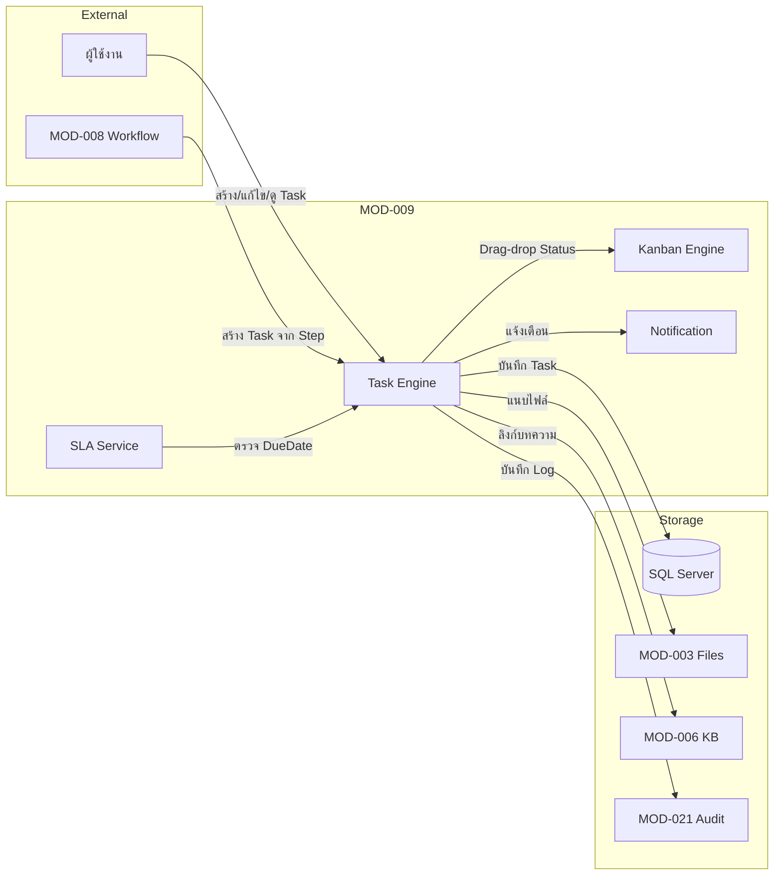
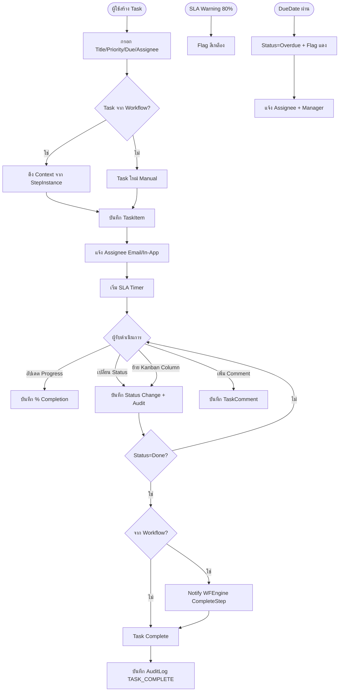
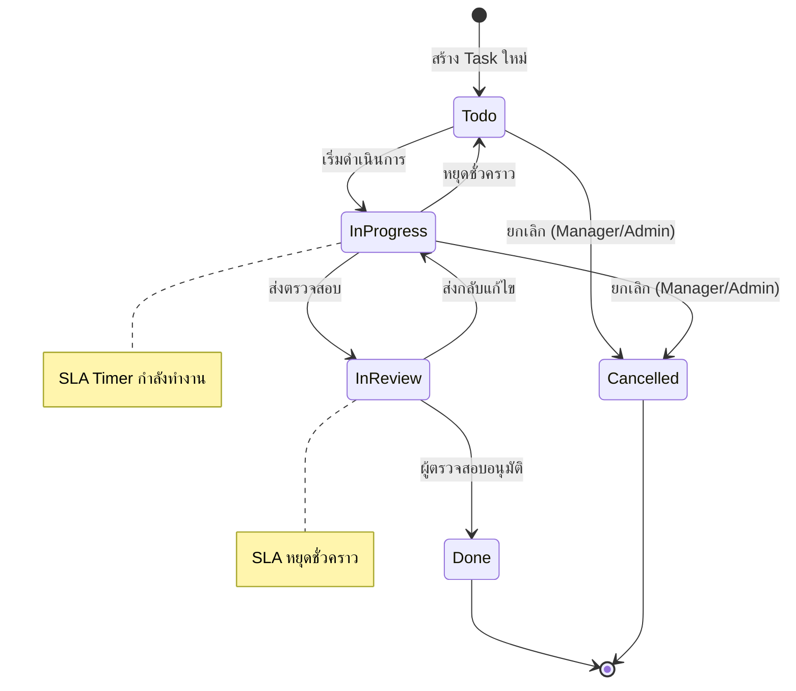
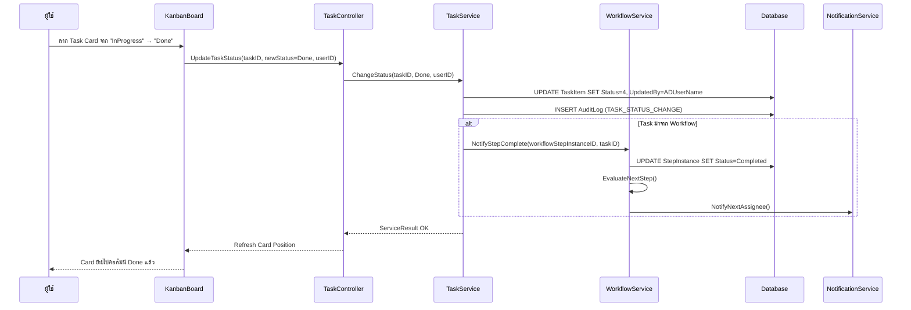

# MOD-009: Task Management
**BR-009 | Core Management System (CMS) | Version 1.0 | มีนาคม 2569**

---

## 3.9.1 Module Overview

| รายการ | รายละเอียด |
|--------|-----------|
| Module ID | MOD-009 |
| Module Name | Task Management |
| BR Reference | BR-009 |
| ผู้ใช้งาน | ทุก Role |
| Priority | Critical |
| Form หลัก | TaskBoardForm, TaskDetailForm, TaskCreateDialog, MyTasksPanel |
| Dependencies | MOD-008 (Workflow), MOD-003 (File), MOD-006 (KB), MOD-020 (User), MOD-021 (Audit) |

**วัตถุประสงค์:** จัดการงานรายบุคคลและทีม รองรับทั้ง Email-style List View และ Kanban Board พร้อมระบบ SLA, การแจ้งเตือน และ Audit Trail

---

## 3.9.2 Class Design

```csharp
public class TaskItem {
    public int TaskID { get; set; }
    public string TaskCode { get; set; }           // TK-2569-00001
    public string Title { get; set; }
    public string Description { get; set; }        // Rich Text HTML
    public int Priority { get; set; }              // 1=Low,2=Medium,3=High,4=Critical
    public int Status { get; set; }                // 1=Todo,2=InProgress,3=InReview,4=Done,5=Cancelled
    public int? ParentTaskID { get; set; }         // FK → TaskItem (Subtask)
    public int SubtaskDepth { get; set; }          // สูงสุด 3 ระดับ
    public decimal CompletionPercent { get; set; } // 0-100
    // Assignment
    public int AssignedToUserID { get; set; }
    public int? AssignedToRoleID { get; set; }
    public int? AssignedToOrgUnitID { get; set; }
    public int CreatedByUserID { get; set; }
    // Dates
    public DateTime? DueDate { get; set; }
    public DateTime? StartDate { get; set; }
    public int? EstimatedHours { get; set; }
    public int? ActualHours { get; set; }
    // Links
    public int? WorkflowStepInstanceID { get; set; }  // จาก Workflow
    public int? ProjectID { get; set; }
    public string[] Tags { get; set; }
    public string[] LinkedFolderIDs { get; set; }
    public string[] LinkedFileIDs { get; set; }
    public string[] LinkedKBArticleIDs { get; set; }
    public string[] LinkedProgramIDs { get; set; }
    // Audit
    public string CreatedBy { get; set; }          // ADUserName
    public DateTime CreatedDate { get; set; }
    public string UpdatedBy { get; set; }
    public DateTime? UpdatedDate { get; set; }
    public DateTime? DeletedDate { get; set; }
    public bool IsDeleted { get; set; }
    public DateTime? RecycleBinExpiry { get; set; } // DeletedDate + 30 วัน
}

public class TaskComment {
    public int CommentID { get; set; }
    public int TaskID { get; set; }
    public int? ParentCommentID { get; set; }      // Threading
    public string Content { get; set; }
    public int ThreadDepth { get; set; }           // สูงสุด 3 ระดับ
    public bool IsEdited { get; set; }
    public string CreatedBy { get; set; }          // ADUserName
    public DateTime CreatedDate { get; set; }
    public DateTime? EditedDate { get; set; }
}

public class TaskAttachment {
    public int AttachmentID { get; set; }
    public int TaskID { get; set; }
    public int FileDocumentID { get; set; }        // FK → FileDocument
    public string CreatedBy { get; set; }
    public DateTime CreatedDate { get; set; }
}

public class KanbanColumn {
    public int ColumnID { get; set; }
    public string ColumnName { get; set; }
    public int MappedStatus { get; set; }          // FK → Status enum
    public int SortOrder { get; set; }
    public string ColorHex { get; set; }
    public bool IsDefault { get; set; }
}
```

---

## 3.9.3 Use Case Diagram

```mermaid
graph TB
    subgraph ผู้ใช้งาน
        AllUser[👤 ทุก Role]
        Manager[👤 Manager/Admin]
    end

    subgraph MOD-009: Task Management
        UC1[ดู Task ของฉัน]
        UC2[สร้าง Task ใหม่]
        UC3[แก้ไข Task]
        UC4[เปลี่ยน Status / Drag-Drop Kanban]
        UC5[สร้าง Subtask]
        UC6[เพิ่ม Comment]
        UC7[แนบไฟล์]
        UC8[ลิงก์ KB / Folder / Program]
        UC9[มอบหมายงาน]
        UC10[ติดตาม SLA]
        UC11[ดู Kanban Board]
        UC12[ดู Email List View]
        UC13[ลบ / กู้คืน Task]
        UC14[Export รายงาน]
    end

    AllUser --> UC1
    AllUser --> UC2
    AllUser --> UC3
    AllUser --> UC4
    AllUser --> UC5
    AllUser --> UC6
    AllUser --> UC7
    AllUser --> UC8
    AllUser --> UC11
    AllUser --> UC12
    Manager --> UC9
    Manager --> UC10
    Manager --> UC13
    Manager --> UC14
```

---

## 3.9.4 Context Diagram



---

## 3.9.5 Data Flow Diagram ระดับ 1



---

## 3.9.6 Activity Diagram



---

## 3.9.7 Sequence Diagram — Kanban Drag & Drop



---

## 3.9.8 API Specifications

| Method | Input | Output | Performance |
|--------|-------|--------|-------------|
| `GetMyTasks(userID, filter)` | int, TaskFilter | PagedResult\<TaskItem\> | < 1 วินาที |
| `GetKanbanBoard(userID, filter)` | int, TaskFilter | KanbanBoardData | < 1 วินาที |
| `GetTaskDetail(taskID)` | int | TaskDetail | < 500ms |
| `CreateTask(task, userID)` | TaskItem, int | ServiceResult\<TaskItem\> | < 2 วินาที |
| `UpdateTask(taskID, task, userID)` | int, TaskItem, int | ServiceResult\<bool\> | < 1 วินาที |
| `ChangeStatus(taskID, status, userID)` | int, int, int | ServiceResult\<bool\> | < 500ms |
| `CreateSubtask(parentTaskID, task, userID)` | int, TaskItem, int | ServiceResult\<TaskItem\> | < 2 วินาที |
| `AddComment(taskID, comment, userID)` | int, TaskComment, int | ServiceResult\<TaskComment\> | < 1 วินาที |
| `DeleteTask(taskID, userID)` | int, int | ServiceResult\<bool\> | Soft delete |
| `RestoreTask(taskID, userID)` | int, int | ServiceResult\<bool\> | จาก Recycle Bin |
| `GetSLAStatus(taskID)` | int | SLAStatus | < 200ms |
| `ExtendDueDate(taskID, newDate, reason, userID)` | int, DateTime, string, int | ServiceResult\<bool\> | ต้องให้เหตุผล |

---

## 3.9.9 Business Logic

- **TK-BL-01:** Task ต้องมี Assignee อย่างน้อย 1 คน; ถ้า Assign ให้ Role → Auto-assign ให้ Manager ของ Role นั้น
- **TK-BL-02:** DueDate ต้องไม่อยู่ในอดีต; ถ้า Task จาก Workflow → DueDate = StepDueDate อัตโนมัติ
- **TK-BL-03:** SLA Warning: ถ้าเวลาผ่านไป 80% ของ (DueDate - CreatedDate) → Flag สีเหลือง
- **TK-BL-04:** Subtask ลึกสูงสุด 3 ระดับ; Parent.CompletionPercent = AVG(Subtask.CompletionPercent)
- **TK-BL-05:** Task Status=Done (Readonly) ยกเว้น Comment; High/Critical → ต้องให้เหตุผลก่อน ExtendDueDate
- **TK-BL-06:** ลบ Task → Soft Delete; RecycleBinExpiry = DeletedDate + 30 วัน
- **TK-BL-07:** Kanban Column Default: Todo/InProgress/InReview/Done; ผู้ใช้ปรับ Column ได้ (บันทึกต่อ User)
- **TK-BL-08:** Audit Stamp ใช้ `UserAccount.ADUserName` ของผู้ดำเนินการ

---

## 3.9.10 Error Handling

| Error Code | สถานการณ์ | ข้อความแสดง |
|------------|-----------|-------------|
| TK-001 | DueDate อยู่ในอดีต | วันกำหนดเสร็จต้องเป็นวันในอนาคต |
| TK-002 | ไม่มี Assignee | กรุณากำหนดผู้รับผิดชอบงาน |
| TK-003 | Subtask เกิน 3 ระดับ | ไม่สามารถสร้าง Subtask เกิน 3 ระดับได้ |
| TK-004 | แก้ไข Task Done | งานที่เสร็จสิ้นแล้วไม่สามารถแก้ไขได้ (เพิ่ม Comment ได้) |
| TK-005 | ExtendDate ไม่มีเหตุผล | กรุณาระบุเหตุผลในการขยายเวลา |
| TK-006 | ลบ Task จาก Workflow | ไม่สามารถลบงานที่เกิดจาก Workflow ได้ กรุณายกเลิก Workflow |
| TK-007 | Assignee ไม่พบ | ไม่พบผู้รับผิดชอบที่ระบุในระบบ |

---

## 3.9.11 Wireframe: Kanban Board

```
╔══════════════════════════════════════════════════════════════════════════╗
║  📋 Task Board                                          [─] [□] [X]    ║
╠══════════════════════════════════════════════════════════════════════════╣
║  [+ สร้าง Task] [📧 List View] [📋 Kanban ●] 🔍[ค้นหา] [กรอง▼]       ║
╠══════════════════════════════════════════════════════════════════════════╣
║  📌 To Do (3)       📂 กำลังทำ (4)     🔍 รอตรวจ (1)    ✅ เสร็จ (8) ║
║  ─────────────  ──────────────  ──────────────  ─────────────         ║
║  ┌─────────────┐ ┌─────────────┐ ┌─────────────┐ ┌─────────────┐      ║
║  │🔴 ตรวจสอบ  │ │🟠 ปรับปรุง  │ │🔵 สรุปผล    │ │🟢 จัดซื้อ   │      ║
║  │ Policy HC   │ │ SOP เคลม    │ │ Q1 2569     │ │ เสร็จ 15/3  │      ║
║  │ → สมชาย    │ │ → วิชัย     │ │ → ผู้จัดการ  │ │             │      ║
║  │ ⏰ 25/3    │ │ ⚠️ 20/3 OD │ │ 🕐 28/3    │ │             │      ║
║  └─────────────┘ └─────────────┘ └─────────────┘ └─────────────┘      ║
╚══════════════════════════════════════════════════════════════════════════╝
```

## 3.9.12 Wireframe: Email List View

```
╔══════════════════════════════════════════════════════════════════════════╗
║  📧 งานของฉัน (Email Style)                              [─] [□] [X]  ║
╠══════════════════════════════════════════════════════════════════════════╣
║  [+ สร้าง] [📧 List ●] [📋 Kanban]  [กรอง: สถานะ▼][มอบหมาย▼][ช่วง▼] ║
╠══════════════════════════════════════════════════════════════════════════╣
║ ☐ │P  │ หัวข้อ                  │ มอบหมายให้ │ กำหนด  │ สถานะ         ║
║ ☐ │🔴 │ ตรวจสอบ Policy HC      │ สมชาย      │ 25/3   │ 📌 To Do      ║
║ ☑ │🟠 │ ปรับปรุง SOP เคลม       │ วิชัย      │ 🔴 OD  │ 📂 กำลังทำ   ║
║ ☐ │🔵 │ สรุปผล Q1 2569         │ ผู้จัดการ  │ 28/3   │ 🔍 รอตรวจ    ║
║ ☐ │🟢 │ ทำ Template ใหม่       │ สุภา       │ 02/4   │ 📌 To Do      ║
╠══════════════════════════════════════════════════════════════════════════╣
║  [✓ทำเครื่องหมายเสร็จ] [มอบหมายใหม่] [ลบ]   < 1 2 3 >   4 รายการ    ║
╚══════════════════════════════════════════════════════════════════════════╝
```
