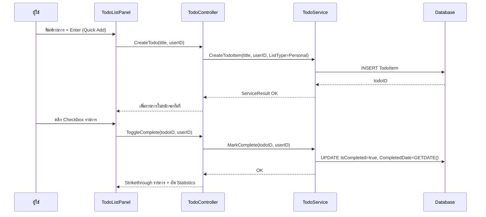
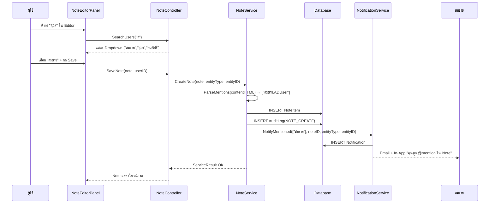

# MOD-010: Todo List Management
**BR-010 | Core Management System (CMS) | Version 1.0 | มีนาคม 2569**

---

## 3.10.1 Module Overview

| รายการ | รายละเอียด |
|--------|-----------|
| Module ID | MOD-010 |
| Module Name | Todo List Management |
| BR Reference | BR-010 |
| ผู้ใช้งาน | ทุก Role (Personal Todo), Manager (Team Todo) |
| Priority | Medium |
| Form หลัก | TodoListPanel, TodoItemDialog |
| Dependencies | MOD-009 (Task), MOD-020 (User) |

---

## 3.10.2 Class Design

```csharp
public class TodoItem {
    public int TodoID { get; set; }
    public string Title { get; set; }
    public int ListType { get; set; }      // 1=Personal,2=Team,3=Project
    public int OwnedByUserID { get; set; }
    public int? SharedOrgUnitID { get; set; }  // Team Todo
    public int? LinkedProjectID { get; set; }   // Project Todo
    public int? LinkedTaskID { get; set; }      // Link ไป Task ใน MOD-009
    public int Priority { get; set; }          // 1=Low,2=Medium,3=High
    public bool IsCompleted { get; set; }
    public DateTime? DueDate { get; set; }
    public string Category { get; set; }
    public int SortOrder { get; set; }
    public bool IsRecurring { get; set; }
    public int? RecurringType { get; set; }    // 1=Daily,2=Weekly,3=Monthly
    public DateTime? RecurringEndDate { get; set; }
    public string CreatedBy { get; set; }       // ADUserName
    public DateTime CreatedDate { get; set; }
    public DateTime? CompletedDate { get; set; }
    public bool IsDeleted { get; set; }
}
```

## 3.10.3 Use Case Diagram

```mermaid
graph TB
    subgraph ผู้ใช้งาน
        User[👤 ทุก Role]
        Manager[👤 Manager]
    end

    subgraph MOD-010
        UC1[เพิ่ม Todo รายการใหม่]
        UC2[ทำเครื่องหมายเสร็จ]
        UC3[ลบ Todo]
        UC4[จัดลำดับ Drag-Drop]
        UC5[ดู Personal Todo]
        UC6[ดู Team Todo]
        UC7[แปลง Todo เป็น Task]
        UC8[ดู Statistics]
        UC9[ตั้ง Recurring]
    end

    User --> UC1
    User --> UC2
    User --> UC3
    User --> UC4
    User --> UC5
    User --> UC7
    User --> UC8
    User --> UC9
    Manager --> UC6
```

## 3.10.4 Sequence Diagram



## 3.10.5 Business Logic

- **TD-BL-01:** Personal Todo → Private เฉพาะเจ้าของ; ไม่ปรากฏให้ผู้อื่นเห็น
- **TD-BL-02:** สูงสุด 100 Active Todo ต่อ User (ไม่นับรายการที่ Complete แล้ว)
- **TD-BL-03:** Recurring Todo → สร้างรายการถัดไปอัตโนมัติเมื่อ Complete (ถ้า RecurringEndDate ยังไม่เกิน)
- **TD-BL-04:** Todo Completed เก็บไว้ 30 วันแล้ว Auto-Archive
- **TD-BL-05:** แปลง Todo เป็น Task → สร้าง TaskItem ใน MOD-009 แล้ว Link กัน (TodoItem.LinkedTaskID)
- **TD-BL-06:** Audit Stamp ใช้ `UserAccount.ADUserName`

## 3.10.6 Error Handling

| Error Code | สถานการณ์ | ข้อความแสดง |
|------------|-----------|-------------|
| TD-001 | Todo เกิน 100 รายการ | คุณมีรายการ Todo ถึงขีดสูงสุดแล้ว (100) กรุณาลบหรือ Complete รายการเก่าก่อน |
| TD-002 | Title ว่าง | กรุณากรอกชื่อรายการ |
| TD-003 | DueDate อดีต | วันกำหนดต้องเป็นวันในอนาคต |

## 3.10.7 Wireframe

```
╔══════════════════════════════════════════════════════╗
║  ✅ Todo ของฉัน                          [─] [□] [X] ║
╠══════════════════════════════════════════════════════╣
║  [📝 Personal ●] [👥 Team] [📁 Project]              ║
║  [+ เพิ่มรายการด่วน...                      ] [Add]  ║
╠══════════════════════════════════════════════════════╣
║  📊 วันนี้: 3/7  ┊ สัปดาห์: 5/12  ┊ 🔥 Streak: 5 วัน ║
╠══════════════════════════════════════════════════════╣
║  [ทั้งหมด▼] [ยังไม่เสร็จ▼] [High First▼]            ║
║ ─────────────────────────────────────────────────── ║
║  ☐ 🔴 ตรวจสอบ Policy ด้านสินไหม  ⏰ วันนี้          ║
║  ☐ 🟠 สรุปรายงานประจำสัปดาห์      📅 25/03           ║
║  ☑ 🟢 ส่ง Email แจ้งทีม          ✓ เสร็จแล้ว        ║
║  ─────────────────────────────────────────────────── ║
║  [ แปลงเป็น Task ] [ สถิติรายสัปดาห์ 📊 ]            ║
╚══════════════════════════════════════════════════════╝
```

---

---

# MOD-011: Notes and Comments System
**BR-011 | Core Management System (CMS) | Version 1.0 | มีนาคม 2569**

---

## 3.11.1 Module Overview

| รายการ | รายละเอียด |
|--------|-----------|
| Module ID | MOD-011 |
| Module Name | Notes and Comments System |
| BR Reference | BR-011 |
| ผู้ใช้งาน | ทุก Role |
| Priority | Medium |
| Form หลัก | NoteEditorPanel, CommentPanel (UserControl ฝังใน Task/Folder) |
| Dependencies | MOD-002 (Folder), MOD-009 (Task), MOD-020 (User), MOD-021 (Audit) |

---

## 3.11.2 Class Design

```csharp
public class NoteItem {
    public int NoteID { get; set; }
    public int EntityType { get; set; }     // 1=Folder, 2=Task, 3=File, 4=Project
    public int EntityID { get; set; }       // FK ตาม EntityType
    public int? ParentNoteID { get; set; }  // Thread Reply
    public int ThreadDepth { get; set; }    // สูงสุด 3 ระดับ
    public string ContentHTML { get; set; } // Rich Text
    public bool IsPinned { get; set; }
    public bool IsImportant { get; set; }
    public bool IsEdited { get; set; }
    public string[] MentionedUserADs { get; set; }  // @mention ADUserName[]
    public string[] Tags { get; set; }
    public string CreatedBy { get; set; }           // ADUserName
    public DateTime CreatedDate { get; set; }
    public DateTime? EditedDate { get; set; }
    public bool IsDeleted { get; set; }             // Soft Delete (Audit ยังเก็บ)
}

public class NoteAttachment {
    public int AttachID { get; set; }
    public int NoteID { get; set; }
    public int FileDocumentID { get; set; }
    public string CreatedBy { get; set; }
    public DateTime CreatedDate { get; set; }
}
```

## 3.11.3 Use Case Diagram

```mermaid
graph TB
    subgraph ผู้ใช้งาน
        AllUser[👤 ทุก Role]
        Admin[👤 Admin]
    end

    subgraph MOD-011
        UC1[เพิ่ม Note/Comment]
        UC2[ตอบกลับ Thread]
        UC3[@mention ผู้ใช้]
        UC4[#tag Keywords]
        UC5[Pin Note สำคัญ]
        UC6[แนบไฟล์]
        UC7[Export เป็น PDF/Word]
        UC8[ค้นหาใน Notes]
        UC9[แก้ไขภายใน 24 ชั่วโมง]
        UC10[ลบ Note ของตัวเอง]
        UC11[แก้ไขหลัง 24 ชม. Admin]
    end

    AllUser --> UC1
    AllUser --> UC2
    AllUser --> UC3
    AllUser --> UC4
    AllUser --> UC5
    AllUser --> UC6
    AllUser --> UC7
    AllUser --> UC8
    AllUser --> UC9
    AllUser --> UC10
    Admin --> UC11
```

## 3.11.4 Sequence Diagram — @Mention Flow



## 3.11.5 Business Logic

- **NT-BL-01:** แก้ไข Note ได้ภายใน 24 ชั่วโมงหลังสร้าง; เกินกว่านั้น Read-Only (Admin แก้ไขได้)
- **NT-BL-02:** Note ที่แก้ไขแล้ว → แสดง "(แก้ไขแล้ว HH:mm)" ใต้เนื้อหา
- **NT-BL-03:** @mention สูงสุด 10 User ต่อ Note; ผู้ถูก Mention ต้องมีสิทธิ์เข้าถึง Entity นั้น
- **NT-BL-04:** ไฟล์แนบใน Note ≤ 10 MB; เก็บใน FileDocument ปกติ (MOD-003)
- **NT-BL-05:** Thread สูงสุด 3 ระดับ; Pin Note อยู่ด้านบนสุดเสมอ
- **NT-BL-06:** Soft Delete Note → เก็บใน AuditLog แต่ซ่อนจาก UI
- **NT-BL-07:** Audit Stamp ใช้ `UserAccount.ADUserName`

## 3.11.6 Error Handling

| Error Code | สถานการณ์ | ข้อความแสดง |
|------------|-----------|-------------|
| NT-001 | แก้ไขหลัง 24 ชั่วโมง ไม่ใช่ Admin | หมดเวลาแก้ไขแล้ว (24 ชั่วโมง) |
| NT-002 | @mention เกิน 10 คน | สามารถ @mention ได้สูงสุด 10 คนต่อ Note |
| NT-003 | @mention ผู้ที่ไม่มีสิทธิ์เข้าถึง | ผู้ใช้ที่ระบุไม่มีสิทธิ์เข้าถึง Note นี้ |
| NT-004 | ไฟล์แนบเกิน 10 MB | ไฟล์แนบต้องไม่เกิน 10 MB |
| NT-005 | Thread เกิน 3 ระดับ | ไม่สามารถตอบกลับลึกกว่า 3 ระดับได้ |

## 3.11.7 Wireframe

```
╔══════════════════════════════════════════════════════════════════╗
║  💬 Notes & Comments — แผนกรับแจ้ง > เอกสาร 3NC   [ยุบ/ขยาย] ║
╠══════════════════════════════════════════════════════════════════╣
║  📌 [PINNED] สรุปมติประชุม 15/03 — สมชาย สุขดี    [Edit][Pin] ║
║     เห็นชอบให้ปรับ SOP เคลมรถยนต์ตามแนวทางใหม่...             ║
║     (แก้ไขแล้ว 15/03 10:35)                                    ║
║  ─────────────────────────────────────────────────────────────  ║
║  💬 สุภา รักงาน 20/03 14:30:                                   ║
║     @สมชาย ขอ Template SOP ใหม่ด้วยนะคะ                       ║
║     └─ 💬 สมชาย 20/03 15:00: แนบไว้ใน KB แล้วครับ 📎          ║
║  ─────────────────────────────────────────────────────────────  ║
║  [B][I][U][🔗][📎]  [เพิ่ม Note / Comment...            ]     ║
║                                           [ 💾 บันทึก ]        ║
╚══════════════════════════════════════════════════════════════════╝
```

---

---

# MOD-012: Work Instructions
**BR-012 | Core Management System (CMS) | Version 1.0 | มีนาคม 2569**

---

## 3.12.1 Module Overview

| รายการ | รายละเอียด |
|--------|-----------|
| Module ID | MOD-012 |
| Module Name | Work Instructions |
| BR Reference | BR-012 |
| ผู้ใช้งาน | ทุก Role (อ่าน), Officer (สร้าง/แก้ไข Draft), Manager (Approve/Publish) |
| Priority | Medium |
| Form หลัก | WorkInstructionEditorForm, WorkInstructionViewerPanel |
| Dependencies | MOD-003 (File), MOD-006 (KB), MOD-009 (Task), MOD-021 (Audit) |

---

## 3.12.2 Class Design

```csharp
public class WorkInstruction {
    public int WIDocID { get; set; }
    public string WICode { get; set; }              // WI-2569-001
    public string Title { get; set; }
    public string ContentHTML { get; set; }
    public int EntityType { get; set; }             // 1=Folder,2=Task,3=Process
    public int EntityID { get; set; }
    public int Status { get; set; }                 // 1=Draft,2=PendingApproval,3=Active,4=Superseded,5=Archived
    public int Version { get; set; }
    public int? SupersededByID { get; set; }        // FK → WIDocID (เวอร์ชันใหม่)
    public DateTime? ReviewDueDate { get; set; }   // Active + 12 เดือน
    public bool RequiresAcknowledgment { get; set; } // สำหรับ Critical Instructions
    public int[] AcknowledgedByUserIDs { get; set; } // ผู้ยืนยันอ่านแล้ว
    public string CreatedBy { get; set; }            // ADUserName
    public DateTime CreatedDate { get; set; }
    public string ApprovedBy { get; set; }           // ADUserName (Supervisor)
    public DateTime? ApprovedDate { get; set; }
    public int HelpfulCount { get; set; }
    public int NotHelpfulCount { get; set; }
}
```

## 3.12.3 Use Case Diagram

```mermaid
graph TB
    subgraph ผู้ใช้งาน
        AllUser[👤 ทุก Role]
        Officer[👤 Officer/Sr.Officer]
        Manager[👤 Supervisor/Manager]
    end

    subgraph MOD-012
        UC1[อ่าน Work Instruction]
        UC2[ให้คะแนน Helpful/Not]
        UC3[แนะนำการปรับปรุง]
        UC4[ดาวน์โหลด PDF]
        UC5[สร้าง/แก้ไข Draft]
        UC6[ส่งขออนุมัติ]
        UC7[Approve/Reject]
        UC8[Archive เวอร์ชันเก่า]
        UC9[ดู Version History]
        UC10[Acknowledge Critical WI]
    end

    AllUser --> UC1
    AllUser --> UC2
    AllUser --> UC3
    AllUser --> UC4
    AllUser --> UC9
    AllUser --> UC10
    Officer --> UC5
    Officer --> UC6
    Manager --> UC7
    Manager --> UC8
```

## 3.12.4 Business Logic

- **WI-BL-01:** Work Instruction Status Flow: Draft → PendingApproval → Active → Archived
- **WI-BL-02:** แก้ไข Active WI → สร้าง Version ใหม่ (เก่า Status=Superseded, SupersededByID=Versionใหม่)
- **WI-BL-03:** ReviewDueDate = ApprovedDate + 365 วัน; Alert ก่อน 30 วัน
- **WI-BL-04:** Critical WI (`RequiresAcknowledgment=true`) → ผู้เกี่ยวข้องต้องกด Acknowledge ก่อนดำเนินงาน
- **WI-BL-05:** Draft → มองเห็นเฉพาะ Author + Manager
- **WI-BL-06:** Audit Stamp ใช้ `UserAccount.ADUserName`

## 3.12.5 Error Handling

| Error Code | สถานการณ์ | ข้อความแสดง |
|------------|-----------|-------------|
| WI-001 | ไม่มีสิทธิ์ Approve | เฉพาะ Supervisor/Manager เท่านั้นที่อนุมัติ Work Instruction ได้ |
| WI-002 | อ่านก่อนดำเนินการ | กรุณายืนยันการอ่าน Work Instruction ก่อนดำเนินการ |
| WI-003 | แก้ไข Active WI โดยตรง | ไม่สามารถแก้ไข Active WI โดยตรง ระบบจะสร้าง Version ใหม่ให้อัตโนมัติ |

## 3.12.6 Wireframe — Work Instruction Viewer

```
╔════════════════════════════════════════════════════════════════╗
║  📄 Work Instruction: วิธีรับแจ้งสินไหม v3.1      [─] [□] [X]║
╠════════════════════════════════════════════════════════════════╣
║  🟢 Active │ อนุมัติโดย: วิชัย │ 15/01/2569 │ Review: 15/01/70 ║
║  [ดู Version เก่า (2)] [📥 Export PDF] [🖨 พิมพ์]              ║
╠════════════════════════════════════════════════════════════════╣
║                                                                ║
║  1. รับโทรศัพท์จากลูกค้าที่ต้องการแจ้งสินไหม                  ║
║  2. บันทึกเลขกรมธรรม์และข้อมูลลูกค้า                         ║
║  3. สร้าง Case ในระบบ Core Insurance System                   ║
║  4. ส่ง SMS ยืนยันการรับแจ้งถึงลูกค้า                        ║
║                                                                ║
╠════════════════════════════════════════════════════════════════╣
║  มีประโยชน์ไหม? [👍 มีประโยชน์ (24)] [👎 ปรับปรุงได้ (2)]    ║
║  [✅ ยืนยันว่าอ่านแล้ว (Critical)] [💬 แนะนำการปรับปรุง]     ║
╚════════════════════════════════════════════════════════════════╝
```
