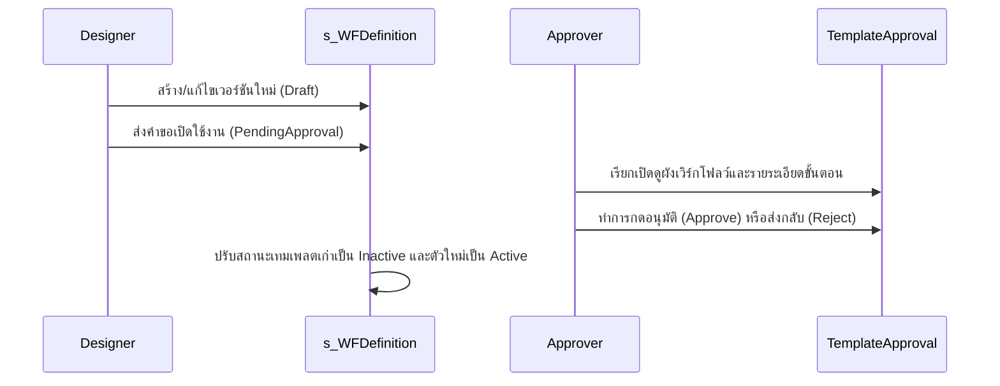

# ข้อกำหนดการย้ายระบบ WFE (Workflow Engine) ไปยัง ASP.NET Core Razor Pages

เอกสารฉบับนี้เป็นข้อกำหนดการออกแบบและโครงสร้างการพัฒนาซอฟต์แวร์สำหรับการย้ายหน้าจอระบบ **Workflow Engine (WFE)** ทั้งหมดจาก WinForms ไปยังเว็บแอปพลิเคชันรูปแบบ **ASP.NET Core Razor Pages** โดยใช้ธีมและการแสดงผลระดับพรีเมียม (Modern Dashboard Layout)

---

## สถาปัตยกรรมเค้าโครงหน้าเว็บร่วม (Shared Layout & Shell)
เพื่อให้ระบบมีพฤติกรรมและการจัดวางหน้าจอที่เหมือนกัน ทุกหน้าเว็บจะใช้โครงสร้างหลักแบบ **Sidebar + Main Content Canvas**:
- **Sidebar**: เมนูแถบข้างแบ่งตามกลุ่มงานตามสเปกของ [WorkflowNavigationBuilder](file:///c:/Users/pitakpong/Documents/cms_import/CMS.Presentation/Modules/WFE/WorkflowNavigationBuilder.cs) (งานของฉัน, ตรวจสอบเวิร์กโฟลว์, เริ่มเวิร์กโฟลว์, จัดการเทมเพลต, ตัวออกแบบระบบ, การมอบหมายงาน, รายงาน SLA)
- **Header**: แสดง Breadcrumb, ข้อมูลผู้ใช้ล็อกอิน และปุ่มดำเนินการส่วนกลาง

---

## 1. หน้ากระดานงานของฉัน (Workflow Dashboard / My Tasks)
* **หน้าของระบบเดิม**: `WorkflowDashboardFormNew.cs`
* **Razor Page**: `/Workflow/Dashboard.cshtml`

### วัตถุประสงค์
แสดงรายการงานของตนเองที่ยังค้างดำเนินการอยู่ (Inbox) และรายการเวิร์กโฟลว์ที่ผู้ใช้คนนี้เป็นคนเริ่มต้น (Outbox)

### โครงสร้าง Backend (`Dashboard.cshtml.cs`)
```csharp
public class DashboardModel : PageModel
{
    private readonly IWorkflowStepInstanceRepository _stepInstanceRepo;
    private readonly IWorkflowInstanceRepository _workflowRepo;

    public List<WorkflowStepInstance> PendingTasks { get; set; } = new List<WorkflowStepInstance>();
    public List<WorkflowInstance> MyInitiatedWorkflows { get; set; } = new List<WorkflowInstance>();

    public void OnGet()
    {
        string username = User.Identity.Name ?? "pitakpong";

        // 1. คิวรีงานที่รอดำเนินการของฉัน (Pending & InProgress)
        // SQL: SELECT * FROM WFE.t_WFStepInstance WHERE AssignedTo = @Username AND Status IN (1, 2) AND IsDeleted = 0
        PendingTasks = _stepInstanceRepo.GetStepInstancesByUser(username)
            .Where(x => x.Status == WorkflowStepInstanceStatus.Pending || x.Status == WorkflowStepInstanceStatus.InProgress)
            .ToList();

        // 2. คิวรีใบงานที่ฉันเป็นคนเริ่ม (My Initiated Workflows)
        // SQL: SELECT * FROM WFE.t_WFInstance WHERE InitiatedBy = @Username AND IsDeleted = 0
        MyInitiatedWorkflows = _workflowRepo.GetInstancesByInitiator(username).ToList();
    }
}
```

### เค้าโครงหน้าเว็บ (View Markup)
- **UI Element**: ใช้แท็บเมนูแยกส่วน (Bootstrap Tabs):
  - **Tab 1: งานที่รออนุมัติ (Inbox)**: แสดงผลในรูปแบบการ์ดตารางพร้อมปุ่มลัดสำหรับเปิดหน้าดำเนินการอนุมัติทันที
  - **Tab 2: รายการที่ฉันเริ่ม (Outbox)**: ตารางแสดงสถานะใบงาน เปอร์เซ็นต์ความคืบหน้า และแถบความคืบหน้า (Progress Bar)
- **พรีเมียมเอฟเฟกต์**: แถบไอคอนบอกความเร่งด่วนของ SLA (หากเหลือน้อยกว่า 4 ชั่วโมงจะเปลี่ยนไอคอนเป็นสีแดงเตือน)

---

## 2. หน้าตรวจสอบเวิร์กโฟลว์ (Workflow Monitor)
* **หน้าของระบบเดิม**: `WorkflowMonitorForm.cs`
* **Razor Page**: `/Workflow/Monitor.cshtml`

### วัตถุประสงค์
ผู้ดูแลระบบหรือหัวหน้างานใช้สำหรับค้นหา ติดตาม และระงับเวิร์กโฟลว์ทั้งหมดในองค์กร

### โครงสร้าง Backend (`Monitor.cshtml.cs`)
```csharp
public class MonitorListModel : PageModel
{
    private readonly IWorkflowService _workflowService;
    
    public PagedResult<WorkflowInstanceResult> WorkflowInstances { get; set; }
    
    [BindProperty(SupportsGet = true)]
    public string SearchQuery { get; set; }
    [BindProperty(SupportsGet = true)]
    public int? SelectedStatus { get; set; }
    [BindProperty(SupportsGet = true)]
    public int PageNum { get; set; } = 1;

    public void OnGet()
    {
        var filter = new WorkflowInstanceFilter {
            PageNumber = PageNum,
            PageSize = 20,
            NameContains = SearchQuery,
            Status = SelectedStatus.HasValue ? (WorkflowInstanceStatus?)SelectedStatus.Value : null
        };
        WorkflowInstances = _workflowService.GetWorkflowInstances(filter, GetUserContext());
    }
}
```

### เค้าโครงหน้าเว็บ (View Markup)
- **ส่วนค้นหา (Search Panel)**: แถบค้นหาอินพุตพร้อมกล่องดรอปดาวน์เลือกกรองตามสถานะ (กำลังทำ, สำเร็จ, ถูกปฏิเสธ, ระงับชั่วคราว)
- **ตารางแสดงผล**: แสดงรหัสอินสแตนซ์ (`WFI-00XXXX`), ชื่อเทมเพลต, ผู้เริ่มกระบวนการ, วันที่เริ่ม, สถานะเวิร์กโฟลว์, ขั้นตอนปัจจุบัน (Current Step) และปุ่มดูรายละเอียดเชิงลึก (`View Detail`) และมุมมองแผนภาพ (`Visual Flow`)

---

## 3. หน้าเริ่มต้นเวิร์กโฟลว์ใหม่ (Start Workflow Wizard)
* **หน้าของระบบเดิม**: `WorkflowCreateTemplateForm.cs` และชุด Wizard Step
* **Razor Page**: `/Workflow/Start.cshtml`

### วัตถุประสงค์
หน้าจอสำหรับผู้ใช้งานในการเลือกเทมเพลตเวิร์กโฟลว์ กรอกข้อมูลเริ่มต้น และกดสั่งเริ่มทำงาน (Start Process)

### โครงสร้าง Backend (`Start.cshtml.cs`)
```csharp
public class StartWorkflowModel : PageModel
{
    private readonly IWorkflowTemplateService _templateService;
    private readonly IWorkflowService _workflowService;

    public IList<WorkflowDefinition> ActiveTemplates { get; set; }
    
    [BindProperty]
    public CreateWorkflowInstanceRequest StartRequest { get; set; }

    public void OnGet()
    {
        // โหลดเทมเพลตที่พร้อมใช้งานทั้งหมด
        // SQL: SELECT * FROM WFE.s_WFDefinition WHERE IsActive = 1 AND IsDeleted = 0
        ActiveTemplates = _templateService.GetActiveTemplates();
    }

    public IActionResult OnPost()
    {
        if (!ModelState.IsValid) return Page();
        
        var result = _workflowService.CreateWorkflowInstance(StartRequest, GetUserContext());
        return RedirectToPage("./Detail", new { id = result.WorkflowInstanceId });
    }
}
```

### เค้าโครงหน้าเว็บ (View Markup)
- **การเลือกเทมเพลต**: หน้าจอแบบตารางการ์ด (Card Grid) ของเทมเพลตเวิร์กโฟลว์ แบ่งหมวดหมู่ (เช่น จัดซื้อ, ทรัพยากรบุคคล, ไอที) พร้อมไอคอนประดับการ์ด
- **หน้ากรอกข้อมูลเริ่มต้น (Modal/Form)**: เมื่อเลือกเทมเพลตแล้ว จะขึ้นฟิลด์ให้กรอกคำอธิบายใบงาน, ลำดับความสำคัญ (ต่ำ/ปานกลาง/สูง) และส่วน Dynamic Form สำหรับใส่พารามิเตอร์ของเวิร์กโฟลว์เพื่อเปลี่ยนทิศทางในโหนดผู้ตัดสินใจต่อไป

---

## 4. หน้าค้นหาประวัติการทำงาน (Workflow History Search)
* **หน้าของระบบเดิม**: `HistorySearchForm.cs`
* **Razor Page**: `/Workflow/History.cshtml`

### วัตถุประสงค์
ค้นหาเวิร์กโฟลว์และประวัติขั้นตอนที่สำเร็จไปแล้วโดยละเอียด รองรับการกรองข้อมูลแบบละเอียดสูง

### ข้อมูลคิวรีฐานข้อมูลหลัก
ใช้คำสั่งคิวรีเพื่อ JOIN ประวัติและตรวจสอบการบันทึก:
```sql
SELECT wsi.WFStepInstanceId, wi.WFInstanceId, wd.WFName, wsi.AssignedTo, 
       wsi.AssignedDate, wsi.CompletedDate, wsi.Status, wsi.CompletedBy
FROM WFE.t_WFStepInstance wsi
JOIN WFE.t_WFInstance wi ON wi.WFInstanceId = wsi.WFInstanceId
JOIN WFE.s_WFDefinition wd ON wd.WFDefinitionId = wi.WFDefinitionId
WHERE wi.IsDeleted = 0 AND wsi.IsDeleted = 0
  AND (@Initiator IS NULL OR wi.InitiatedBy = @Initiator)
  AND (@StartDate IS NULL OR wsi.CompletedDate >= @StartDate)
  AND (@EndDate IS NULL OR wsi.CompletedDate <= @EndDate)
```

### เค้าโครงหน้าเว็บ (View Markup)
- หน้าจอนี้เน้นไปที่ส่วนกรองข้อมูลแบบพับเก็บได้ (Accordion) คัดกรองตาม ช่วงวันที่ประมวลผลเสร็จ, ผู้ประมวลผลเสร็จ, ผู้เริ่มต้น หรือตามชื่อเทมเพลต
- ด้านบนตารางมีปุ่มส่งออกข้อมูลประวัติการทำรายการออกเป็นไฟล์ Excel/CSV (ใช้ `js-xlsx` หรือไลบรารีส่งออกฝั่งเซิร์ฟเวอร์ EPPlus)

---

## 5. หน้าจัดการเทมเพลตเวิร์กโฟลว์ (Template List & Versioning)
* **หน้าของระบบเดิม**: `WorkflowTemplateListForm.cs`
* **Razor Page**: `/Workflow/TemplateList.cshtml`

### วัตถุประสงค์
หน้าต่างสำหรับนักออกแบบระบบในการดูแลภาพรวมเทมเพลตเวิร์กโฟลว์ เวอร์ชันต่างๆ และดูจำนวน instance ที่ยังรันอยู่ของเวอร์ชันนั้นๆ

### โครงสร้างคิวรีคอลัมน์คำนวณหลังบ้าน
ในตัว repository ดึงรายการเทมเพลต จะประเมินฟิลด์เหล่านี้ขึ้นมาแสดงผล:
```sql
SELECT d.WFDefinitionId, d.WFName, d.Version, d.IsActive, d.ApprovalStatus,
       (SELECT COUNT(*) FROM WFE.s_WFStep WHERE WFDefinitionId = d.WFDefinitionId) AS StepCount,
       (SELECT COUNT(*) FROM WFE.t_WFInstance WHERE WFDefinitionId = d.WFDefinitionId AND Status NOT IN (3,4)) AS ActiveInstanceCount
FROM WFE.s_WFDefinition d
WHERE d.IsDeleted = 0
```

### เค้าโครงหน้าเว็บ (View Markup)
- ตารางเทมเพลต พร้อมสีระบุสถานะเวอร์ชัน เช่น เวอร์ชันปัจจุบันที่เป็น `Active` จะเป็นสีเขียว เวอร์ชันเก่าที่เป็น `Inactive` จะเป็นสีเทา และเวอร์ชันแบบร่าง `Draft` จะเป็นสีฟ้า
- มีปุ่มเมนูด่วนเพื่อโคลนเวอร์ชันเก่าออกเป็นแบบร่างใหม่ (New Version Draft) เพื่อนำเข้าสู่หน้าจอออกแบบต่อไป

---

## 6. หน้าตัวออกแบบระบบเวิร์กโฟลว์ (Workflow Designer Canvas)
* **หน้าของระบบเดิม**: `WorkflowDesignerForm.cs`
* **Razor Page**: `/Workflow/Designer.cshtml`

### วัตถุประสงค์
เครื่องมือแบบลากวางเวิร์กโฟลว์เพื่อกำหนดเส้นทางการอนุมัติ กำหนดผู้รับผิดชอบ และตั้งค่า SLA ของแต่ละขั้นตอน

### กลยุทธ์การพอร์ตส่วนออกแบบนี้ไปยังหน้าเว็บ (Web-based Canvas Strategy)
เนื่องจากการวาดภาพลากวางของ WinForms ใช้ระบบพิกัดภายในและการลากคอนโทรล แนะนำให้ใช้ไลบรารี Javascript ยอดนิยมสำหรับการทำกระบวนการออกแบบบนเว็บดังนี้:
1. **[Rete.js](https://retejs.org/)** หรือ **[React Flow](https://reactflow.dev/) / [Vue Flow](https://vueflow.dev/)**: ช่วยจัดการระบบโหนด พิกัด X, Y การเชื่อมสาย (Connections) และระบบซูมหน้าจอได้อย่างมีประสิทธิภาพสูงสุด
2. **การบันทึกข้อมูล**: เมื่อออกแบบเสร็จ และผู้ใช้อยากกดบันทึก โครงสร้างจะถูกแปลงเป็น JSON ในรูปแบบเดียวกับ `TemplateDefinition` ดังนี้:

```json
{
  "Steps": [
    { "WorkflowStepId": 1, "StepName": "Start", "StepType": "Start", "CanvasX": 100, "CanvasY": 200 },
    { "WorkflowStepId": 2, "StepName": "Manager Approval", "StepType": "Approval", "CanvasX": 300, "CanvasY": 200 }
  ],
  "Connections": [
    { "FromStepId": 1, "ToStepId": 2, "Condition": "" }
  ]
}
```
ส่งข้อมูลกลับผ่าน Axios หรือ Fetch ในรูปแบบ POST เพื่อให้ Backend เก็บลงฐานข้อมูลคอลัมน์ `TemplateDefinition` และคลี่ข้อมูลลงตาราง `s_WFStep` และ `s_WFConnection` สำหรับการนำไปรันประมวลผลจริง

---

## 7. หน้าอนุมัติเทมเพลตเวิร์กโฟลว์ (Template Approval Form)
* **หน้าของระบบเดิม**: `TemplateApprovalForm.cs`
* **Razor Page**: `/Workflow/TemplateApproval.cshtml`

### วัตถุประสงค์
สำหรับผู้จัดการในการเข้าตรวจสอบเทมเพลตที่มีสถานะรอการอนุมัติ (`PendingApproval`) ตรวจโครงสร้างเวิร์กโฟลว์แบบภาพก่อนตัดสินใจเซ็นอนุมัติให้อินสแตนซ์พร้อมเปิดใช้งานจริง

### ลำดับเหตุการณ์ (Workflow Lifecycle)


### เค้าโครงหน้าเว็บ (View Markup)
- แสดงข้อมูลเปรียบเทียบความแตกต่าง (Version Diff) เช่น จำนวนขั้นตอนที่เปลี่ยนไป เงื่อนไขที่แก้ไข
- ตัวเล่นภาพผังขั้นตอนแบบ Read-only SVG เพื่อดูเส้นทาง และกล่องให้ใส่ข้อความคำอธิบายประกอบการอนุมัติ/ปฏิเสธ

---

## 8. หน้าจอตั้งค่าการมอบหมายงานแทน (Workflow Delegation)
* **หน้าของระบบเดิม**: `WorkflowDelegationForm.cs`
* **Razor Page**: `/Workflow/Delegation.cshtml`

### วัตถุประสงค์
เพื่อให้ผู้ใช้งานเวิร์กโฟลว์สามารถมอบสิทธิ์ (Delegation Rule) ให้กับเพื่อนร่วมงานปฏิบัติหน้าที่อนุมัติงานแทนได้ชั่วคราวในช่วงเวลาที่ลางานหรือไม่ปฏิบัติหน้าที่

### โครงสร้างข้อมูลตาราง `WFE.t_WFDelegation` (ตัวอย่างพฤติกรรมการประมวลผล)
* เมื่อระบบประมวลผลมาถึงขั้นตอนการสร้างใบงานขั้นตอน `t_WFStepInstance` ระบบจะเช็คตารางมอบสิทธิ์:
```sql
SELECT TOP 1 DelegateToUser
FROM   WFE.t_WFDelegation
WHERE  DelegatorUser = @TargetUser
  AND  GETDATE() BETWEEN StartDate AND EndDate
  AND  IsActive = 1
```
หากพบข้อมูล ระบบจะตั้งฟิลด์ `AssignedTo` เป็นรหัสพนักงานของผู้รับมอบงานแทนอัตโนมัติ

### เค้าโครงหน้าเว็บ (View Markup)
- ส่วนสร้างกฎใหม่: ฟอร์มเลือกผู้รับสิทธิ์ทำงานแทน, ปฏิทินเลือกวันเริ่มต้นและวันสิ้นสุด, เลือกจำกัดเฉพาะบางประเภทเทมเพลตเวิร์กโฟลว์
- ส่วนรายการ: ตารางแสดงประวัติกฎเดิมที่มีอยู่ พร้อมปุ่มปิดใช้งานชั่วคราว (Toggle Switch)

---

## 9. หน้าประเมินผลรายงาน SLA (SLA Reporting & Analytics)
* **หน้าของระบบเดิม**: `SLAReportForm.cs`
* **Razor Page**: `/Workflow/SLAReport.cshtml`

### วัตถุประสงค์
แสดงข้อมูลสถิติของเวิร์กโฟลว์และเวลาประมวลผลเปรียบเทียบกับเป้าหมาย SLA (Service Level Agreement)

### การทำแผนภูมิสถิติแดชบอร์ดบนหน้าเว็บ (Web Analytics Charts)
- แนะนำให้ใช้ไลบรารี **[Chart.js](https://www.chartjs.org/)** หรือ **[ApexCharts](https://apexcharts.com/)** ในการวาดกราฟสถิติแทนการใช้ Chart component ในรูปแบบเดิมของ WinForms
- **ข้อมูลที่จะใช้ในแผนภูมิ**:
  1. **แผนภูมิวงกลม (Pie Chart)**: สัดส่วนการทำงานเสร็จทันกำหนดเวลา (On-Time) เปรียบเทียบกับ ทำงานล่าช้ากว่ากำหนด (Overdue)
  2. **แผนภูมิแท่งเปรียบเทียบ (Bar Chart)**: ระยะเวลาประมวลผลเฉลี่ย (วัน) แยกตามประเภทเวิร์กโฟลว์
  3. **ตารางแสดงข้อขัดข้อง (Bottleneck Steps)**: แสดงโหนดขั้นตอนที่ล่าช้าบ่อยที่สุด โดยคิวรีดึงสัดส่วนล่าช้า:

```sql
SELECT TOP 10 StepName, COUNT(*) AS OverdueCount, AVG(DATEDIFF(hour, AssignedDate, CompletedDate)) AS AvgDurationHours
FROM   WFE.t_WFStepInstance wsi
JOIN   WFE.s_WFStep ws ON ws.WFStepId = wsi.WFStepId
WHERE  wsi.SLAStatus = 3 -- Overdue
GROUP BY StepName
ORDER BY OverdueCount DESC
```

---

## 10. หน้าแสดงรายละเอียดและจัดการใบงานขั้นตอน (Workflow Detail & Action Form)
* **หน้าของระบบเดิม**: `WorkflowDetailFormNew.cs`
* **Razor Page**: `/Workflow/Detail.cshtml`

### วัตถุประสงค์
หน้าจอหลักสำหรับจัดการใบงานเวิร์กโฟลว์ฉบับเดี่ยวๆ ใช้สำหรับตัดสินใจ (อนุมัติ/ปฏิเสธ), คืนงาน, มอบหมายใหม่ และแสดงประวัติความคืบหน้าแบบแกนต์ชาร์ตหรือเส้นไทม์ไลน์

### ส่วนประกอบย่อยที่สำคัญในหน้าจอเว็บ
1. **การ์ดข้อมูลสรุปใบงาน**: แสดงชื่อเรื่อง ผู้เริ่มต้น ความสำคัญ และข้อมูลพารามิเตอร์เริ่มต้นของใบงาน
2. **ประวัติและเส้นลำดับการดำเนินการ (Audit Timeline)**: รายการเรียงตามลำดับเวลาตั้งแต่เปิดจนถึงปัจจุบัน แสดงรูปไอคอนของผู้ทำรายการ สถานะการประมวลผล และ Remarks ความคิดเห็น
3. **แถบการดำเนินการ (Action Box)**:
   - แสดงปุ่มดำเนินการตามสิทธิ์และเงื่อนไขของโหนดปัจจุบัน (เช่น ปรากฏปุ่ม **Approve** และ **Reject** เฉพาะผู้ที่มีรหัสพนักงานตรงกับ `AssignedTo` ในขั้นตอนปัจจุบัน)
   - ฟิลด์ใส่เหตุผลคำอธิบายการอนุมัติ (Remarks)
   - ความสามารถในการเปลี่ยนผู้รับผิดชอบ (**Reassign**) ผ่านดรอปดาวน์พนักงาน
