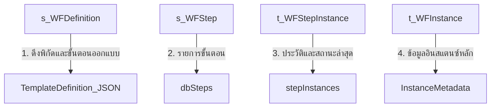

# คู่มือการพัฒนาหน้าจอติดตามกระบวนการทำงาน (Workflow Visual Flow Monitor) ด้วย Razor Pages

เอกสารฉบับนี้เป็นคู่มือสรุปโครงสร้างฐานข้อมูล แนวคิดการทำงาน และโค้ดตัวอย่างสำหรับการย้ายระบบติดตามขั้นตอนการทำงาน (Visual Flow Monitor) จาก WinForms ไปยังเว็บแอปพลิเคชันด้วย **ASP.NET Core Razor Pages**

---

## 1. โครงสร้างฐานข้อมูลและการไหลของข้อมูล (Data Flow)

การแสดงผลแผนภาพและสถานะสีของแต่ละขั้นตอน จะต้องเชื่อมโยงข้อมูลจากตารางหลักๆ ของ Workflow Engine ดังนี้:



### ตารางที่เกี่ยวข้อง
1. **`WFE.s_WFDefinition`**: เก็บข้อมูลเทมเพลตต้นแบบของเวิร์กโฟลว์ คอลัมน์สำคัญคือ `TemplateDefinition` (เก็บ JSON ที่กำหนดพิกัด X, Y และความสัมพันธ์จากหน้า Designer)
2. **`WFE.s_WFStep`**: เก็บรหัสและชื่อขั้นตอนของกระบวนการที่ลงทะเบียนไว้ในฐานข้อมูล มี `WFStepId` (SQL ID)
3. **`WFE.s_WFConnection`**: เก็บเส้นเชื่อมต่อระหว่างขั้นตอนที่บันทึกไว้ในฐานข้อมูล
4. **`WFE.t_WFInstance`**: เก็บข้อมูลกระบวนการที่ถูกรันขึ้นมาทำงาน มี `InputParameters` เก็บตัวแปรเริ่มต้น (JSON)
5. **`WFE.t_WFStepInstance`**: เก็บบันทึกการอนุมัติและประวัติการทำงานของขั้นตอนจริง รวมถึงผู้ประมวลผล วันเวลา และผลลัพธ์สถานะ

---

## 2. โครงสร้างของพารามิเตอร์และการเปลี่ยนทิศทางขั้นตอน (Parameters & Conditions)

เพื่อให้กระบวนการทำงานสามารถวิ่งไปยังทางแยกที่ถูกต้องได้ (เช่น `Decision 6` วิ่งไป `Parallel 4` หรือ `Parallel 3` ตามมูลค่าที่ส่งเข้ามา):
- **การส่งพารามิเตอร์**: เมื่อเริ่มเวิร์กโฟลว์ จะเก็บค่าพารามิเตอร์เริ่มต้นไว้ในคอลัมน์ `InputParameters` ของตาราง `WFE.t_WFInstance` ในรูปแบบ JSON เช่น `{"amount": 7500, "project": "CMS"}`
- **เงื่อนไขเชื่อมโยง (Conditions)**: ในตาราง `WFE.s_WFConnection` จะเก็บนิพจน์ (Expression) เช่น `amount > 5000` หรือ `amount <= 0` ไว้ในฟิลด์ `ConditionExpression`
- **การประมวลผล (Evaluation)**: ระบบจะอ่านค่าพารามิเตอร์จาก instance มารวมเข้ากับเงื่อนไขในเส้นทางและประเมินผลผ่านไลบรารีสคริปต์ (เช่น [NCalc](https://github.com/ncalc/ncalc) หรือคลาสตรวจสอบนิพจน์แบบไดนามิก)

---

## 3. ส่วนของ Backend: Razor PageModel (`Monitor.cshtml.cs`)

ด้านล่างนี้คือโค้ดตัวอย่างของ **PageModel** ใน C# ที่ดึงข้อมูลจากฐานข้อมูล โหลดพิกัดการออกแบบจาก JSON แมปค่ารหัสโหมดออกแบบ (Design ID) เข้ากับรหัสฐานข้อมูล (SQL ID) และดึงข้อมูลประวัติเวิร์กโฟลว์:

```csharp
using System;
using System.Collections.Generic;
using System.Linq;
using Microsoft.AspNetCore.Mvc;
using Microsoft.AspNetCore.Mvc.RazorPages;
using Newtonsoft.Json;
using CMS.Domain.Models;
using CMS.Domain.Enums;
using CMS.Services.Interfaces;
using CMS.Services.DTOs;

namespace CMS.Web.Pages.Workflow
{
    public class MonitorModel : PageModel
    {
        private readonly IWorkflowService _workflowService;
        private readonly IWorkflowTemplateService _templateService;

        public MonitorModel(IWorkflowService workflowService, IWorkflowTemplateService templateService)
        {
            _workflowService = workflowService;
            _templateService = templateService;
        }

        // ตัวแปรสำหรับนำไปผูกข้อมูลใน View (.cshtml)
        public WorkflowInstanceResult InstanceMetadata { get; set; }
        public List<WebWorkflowStep> ViewSteps { get; set; } = new List<WebWorkflowStep>();
        public List<WebWorkflowConnection> ViewConnections { get; set; } = new List<WebWorkflowConnection>();
        public List<WorkflowStepInstance> StepInstances { get; set; } = new List<WorkflowStepInstance>();

        [BindProperty(SupportsGet = true)]
        public int InstanceId { get; set; }

        public IActionResult OnGet()
        {
            if (InstanceId <= 0)
            {
                return RedirectToPage("./Dashboard");
            }

            // 1. ดึงข้อมูล Metadata ของ Workflow Instance
            InstanceMetadata = _workflowService.GetWorkflowInstance(InstanceId, GetCurrentUserContext());
            if (InstanceMetadata == null)
            {
                return NotFound("ไม่พบข้อมูล Workflow Instance ที่ระบุ");
            }

            // 2. ดึงประวัติขั้นตอนจริงที่เกิดขึ้นแล้วจากฐานข้อมูล
            StepInstances = _workflowService.GetStepInstancesByWorkflow(InstanceId).ToList();

            // 3. โหลดโครงสร้างและพิกัดการวาดจาก Template Definition (JSON)
            var template = _templateService.GetTemplate(InstanceMetadata.WorkflowDefinitionId);
            if (template != null && !string.IsNullOrWhiteSpace(template.TemplateDefinition))
            {
                ParseAndMapTemplate(template.TemplateDefinition, InstanceMetadata.WorkflowDefinitionId);
            }
            else
            {
                // ตกกลับไปใช้ Auto Layout หากไม่พบข้อมูลพิกัดใน JSON
                GenerateAutoLayout();
            }

            return Page();
        }

        private void ParseAndMapTemplate(string jsonDefinition, int definitionId)
        {
            var designerDef = JsonConvert.DeserializeObject<WorkflowDesignerTemplateDefinition>(jsonDefinition);
            if (designerDef?.Steps == null) return;

            // ดึงขั้นตอนที่เป็น SQL ID จากฐานข้อมูล
            var dbSteps = _workflowService.GetStepsByTemplate(definitionId).ToList();
            var designToSqlMap = new Dictionary<int, int>();

            // สร้างการเชื่อมโยงข้อมูลโดยการ Trim ตัวอักษรและเปรียบเทียบ Case-Insensitive เพื่อป้องกันปัญหาวรรคตอนหลุด
            foreach (var s in designerDef.Steps)
            {
                var matchedDbStep = dbSteps.FirstOrDefault(db => 
                    string.Equals((db.StepName ?? "").Trim(), (s.StepName ?? "").Trim(), StringComparison.OrdinalIgnoreCase));
                
                int mappedId = matchedDbStep != null ? matchedDbStep.WorkflowStepId : s.WorkflowStepId;
                designToSqlMap[s.WorkflowStepId] = mappedId;

                // ตรวจหาประวัติขั้นตอนว่าเสร็จสิ้นหรือกำลังทำอยู่
                var stepInstance = StepInstances.FirstOrDefault(si => si.WorkflowStepId == mappedId);
                string statusClass = "pending";
                string subText = "";

                if (stepInstance != null)
                {
                    if (stepInstance.Status == WorkflowStepInstanceStatus.Completed)
                    {
                        statusClass = "completed";
                        subText = $"{stepInstance.CompletedBy} · {stepInstance.CompletedDate:dd/MM HH:mm}";
                    }
                    else if (stepInstance.Status == WorkflowStepInstanceStatus.InProgress || stepInstance.Status == WorkflowStepInstanceStatus.Pending)
                    {
                        statusClass = "in-progress";
                        var diff = stepInstance.SLADeadline - DateTime.Now;
                        subText = diff.TotalMinutes < 0 ? "ล่วงเลยกำหนด SLA" : $"{FormatTimeSpan(diff)} ที่เหลืออยู่";
                    }
                    else if (stepInstance.Status == WorkflowStepInstanceStatus.Rejected)
                    {
                        statusClass = "rejected";
                        subText = "ถูกปฏิเสธ";
                    }
                }

                ViewSteps.Add(new WebWorkflowStep
                {
                    StepId = mappedId,
                    StepName = s.StepName.Trim(),
                    StepType = s.StepType,
                    X = s.CanvasX,
                    Y = s.CanvasY,
                    Width = 110,
                    Height = 44,
                    StatusClass = statusClass,
                    SubText = subText,
                    StepInstanceDetails = stepInstance
                });
            }

            // แมปเส้นทางเชื่อมต่อ (Connections)
            if (designerDef.Connections != null)
            {
                foreach (var c in designerDef.Connections)
                {
                    int fromId = designToSqlMap.TryGetValue(c.FromStepId, out int fId) ? fId : c.FromStepId;
                    int toId = designToSqlMap.TryGetValue(c.ToStepId, out int tId) ? tId : c.ToStepId;

                    ViewConnections.Add(new WebWorkflowConnection
                    {
                        FromStepId = fromId,
                        ToStepId = toId,
                        Condition = c.Condition
                    });
                }
            }
        }

        private string FormatTimeSpan(TimeSpan ts)
        {
            if (ts.TotalDays >= 1) return $"{(int)ts.TotalDays} วัน";
            if (ts.TotalHours >= 1) return $"{(int)ts.TotalHours} ชม.";
            return $"{(int)ts.TotalMinutes} นาที";
        }

        private void GenerateAutoLayout() { /* โค้ดสร้างพิกัดสำรองกรณีไม่พบคอนฟิก JSON */ }
        private UserContext GetCurrentUserContext() => new UserContext { ADUserName = User.Identity.Name ?? "System" };
    }

    // โมเดลสำหรับหน้าเว็บ
    public class WebWorkflowStep
    {
        public int StepId { get; set; }
        public string StepName { get; set; }
        public string StepType { get; set; }
        public int X { get; set; }
        public int Y { get; set; }
        public int Width { get; set; }
        public int Height { get; set; }
        public string StatusClass { get; set; }
        public string SubText { get; set; }
        public WorkflowStepInstance StepInstanceDetails { get; set; }
    }

    public class WebWorkflowConnection
    {
        public int FromStepId { get; set; }
        public int ToStepId { get; set; }
        public string Condition { get; set; }
    }
}
```

---

## 4. ส่วนของ Frontend: Razor View และ HTML/SVG Rendering (`Monitor.cshtml`)

การทำ Visual Flow บนเว็บให้คมชัดและตอบสนองได้ดี แนะนำให้ใช้ **SVG (Scalable Vector Graphics)** ซึ่งรองรับสไตล์ภายนอก (CSS) สามารถขยายภาพโดยไม่สูญเสียความคมชัด และผูกอีเวนต์การคลิกด้วย JavaScript ได้อย่างง่ายดาย:

```html
@page "{handler?}"
@model CMS.Web.Pages.Workflow.MonitorModel
@{
    ViewData["Title"] = "Visual Flow - WFI-" + Model.InstanceId.ToString("D6");
}

<!-- ส่วนสไตล์เพื่อความสวยงามระดับพรีเมียม (Glassmorphism & Color Theme) -->
<style>
    .monitor-container {
        display: flex;
        height: calc(100vh - 120px);
        background-color: #f8fafc;
        font-family: 'Inter', 'Segoe UI', sans-serif;
    }
    .flow-canvas-wrapper {
        flex: 1;
        position: relative;
        overflow: auto;
        border-right: 1px solid #e2e8f0;
        background-image: radial-gradient(#cbd5e1 1px, transparent 1px);
        background-size: 20px 20px;
    }
    .right-sidebar {
        width: 320px;
        background: white;
        padding: 24px;
        box-shadow: -2px 0 10px rgba(0, 0, 0, 0.05);
        overflow-y: auto;
    }
    
    /* สไตล์สีสำหรับโหนดเวิร์กโฟลว์ */
    .node-box {
        cursor: pointer;
        transition: transform 0.2s, filter 0.2s;
    }
    .node-box:hover {
        transform: scale(1.03);
        filter: drop-shadow(0 4px 6px rgba(0,0,0,0.1));
    }
    
    .node-rect {
        fill: white;
        stroke: #e2e8f0;
        stroke-width: 1.5;
        rx: 8;
        ry: 8;
    }
    
    /* ส่วนหัวโหนดแยกตามสถานะสี */
    .node-header {
        height: 6px;
    }
    .node-box.completed .node-header-bar { fill: #22c55e; } /* สีเขียว */
    .node-box.completed .node-rect { stroke: #22c55e; }
    
    .node-box.in-progress .node-header-bar { fill: #f97316; } /* สีส้ม */
    .node-box.in-progress .node-rect { stroke: #f97316; stroke-width: 2.5; }
    
    .node-box.pending .node-header-bar { fill: #94a3b8; } /* สีเทา */
    
    .node-box.rejected .node-header-bar { fill: #ef4444; } /* สีแดง */
    .node-box.rejected .node-rect { stroke: #ef4444; }
    
    /* ทางแยกตัดสินใจแบบเพชร */
    .decision-diamond {
        fill: white;
        stroke: #64748b;
        stroke-width: 1.5;
    }
    .node-box.in-progress .decision-diamond {
        stroke: #f97316;
        stroke-width: 2.5;
    }
    
    /* เส้นแสดงความสัมพันธ์ */
    .connection-line {
        fill: none;
        stroke: #94a3b8;
        stroke-width: 1.5;
        marker-end: url(#arrow);
        transition: stroke 0.2s;
    }
    .connection-line:hover {
        stroke: #475569;
        stroke-width: 2.5;
    }
    .condition-text {
        font-size: 10px;
        fill: #64748b;
        font-weight: 500;
        background: white;
    }
</style>

<div class="monitor-container">
    <!-- 1. ส่วน Canvas แสดงผล Visual Flow (SVG) -->
    <div class="flow-canvas-wrapper" id="canvasWrapper">
        <div style="padding: 16px; border-bottom: 1px solid #e2e8f0; background: white;">
            <h4 class="m-0 text-dark">Visual Flow — WFI-@Model.InstanceMetadata.WorkflowInstanceId.ToString("D6")</h4>
            <span class="text-muted small">@Model.InstanceMetadata.TemplateName (v@Model.InstanceMetadata.TemplateVersion) · มุมมอง Live</span>
        </div>

        <svg width="1200" height="500" style="min-width: 100%; min-height: 100%;">
            <!-- กำหนดหัวลูกศร (Marker) -->
            <defs>
                <marker id="arrow" viewBox="0 0 10 10" refX="8" refY="5" markerWidth="6" markerHeight="6" orient="auto-start-reverse">
                    <path d="M 0 0 L 10 5 L 0 10 z" fill="#94a3b8" />
                </marker>
            </defs>

            <!-- A. วาดเส้นเชื่อมโยงความสัมพันธ์ระหว่างขั้นตอน -->
            @foreach (var conn in Model.ViewConnections)
            {
                var fromNode = Model.ViewSteps.FirstOrDefault(s => s.StepId == conn.FromStepId);
                var toNode = Model.ViewSteps.FirstOrDefault(s => s.StepId == conn.ToStepId);

                if (fromNode != null && toNode != null)
                {
                    // คำนวณพิกัดจุดเริ่มต้นจากกึ่งกลางขวา และปลายทางที่กึ่งกลางซ้ายของโหนดถัดไป
                    int x1 = fromNode.X + fromNode.Width;
                    int y1 = fromNode.Y + (fromNode.Height / 2);
                    int x2 = toNode.X;
                    int y2 = toNode.Y + (toNode.Height / 2);

                    int cx1 = x1 + 40;
                    int cy1 = y1;
                    int cx2 = x2 - 40;
                    int cy2 = y2;

                    // วาดเส้นแบบโค้งเบซิเยร์ (Bezier Curve)
                    <path d="M @x1 @y1 C @cx1 @cy1, @cx2 @cy2, @x2 @y2" class="connection-line" />

                    // วาดข้อความเงื่อนไขทับบนจุดกึ่งกลางของเส้นโค้ง
                    if (!string.IsNullOrEmpty(conn.Condition))
                    {
                        int midX = (x1 + x2) / 2;
                        int midY = (y1 + y2) / 2 - 5;
                        <text x="@midX" y="@midY" text-anchor="middle" class="condition-text">@conn.Condition</text>
                    }
                }
            }

            <!-- B. วาดโหนดขั้นตอนการทำงาน -->
            @foreach (var step in Model.ViewSteps)
            {
                if (string.Equals(step.StepType, "Decision", StringComparison.OrdinalIgnoreCase))
                {
                    // วาดโหนดทางแยกรูปเพชร (Diamond)
                    int cx = step.X + (step.Width / 2);
                    int cy = step.Y + (step.Height / 2);
                    int hw = step.Width / 2;
                    int hh = step.Height / 2;
                    
                    <g class="node-box @step.StatusClass" data-step-id="@step.StepId" onclick="selectStep(@step.StepId)">
                        <polygon points="@cx,@(cy - hh) @(cx + hw),@cy @cx,@(cy + hh) @(cx - hw),@cy" class="decision-diamond" />
                        <text x="@cx" y="@(cy + 4)" font-size="11" font-weight="bold" fill="#1e293b" text-anchor="middle">@step.StepName</text>
                    </g>
                }
                else
                {
                    // วาดโหนดรูปสี่เหลี่ยมโค้งมนธรรมดา (Rounded Rectangle) พร้อมแถบหัวสีด้านบน
                    <g class="node-box @step.StatusClass" data-step-id="@step.StepId" onclick="selectStep(@step.StepId)">
                        <rect x="@step.X" y="@step.Y" width="@step.Width" height="@step.Height" class="node-rect" />
                        
                        <!-- แถบสีด้านบนบอกสถานะ -->
                        <path d="M @(step.X) @(step.Y + 6) A 6 6 0 0 1 @(step.X + 6) @(step.Y) L @(step.X + step.Width - 6) @(step.Y) A 6 6 0 0 1 @(step.X + step.Width) @(step.Y + 6) L @(step.X + step.Width) @(step.Y + 6) L @(step.X) @(step.Y + 6) Z" class="node-header-bar" />
                        
                        <!-- ชื่อของขั้นตอน -->
                        <text x="@(step.X + (step.Width / 2))" y="@(step.Y + 22)" font-size="11" font-weight="bold" fill="#1e293b" text-anchor="middle">@step.StepName</text>
                        
                        <!-- วันเวลา / ข้อมูล SLA ด้านล่าง -->
                        @if (!string.IsNullOrEmpty(step.SubText))
                        {
                            <text x="@(step.X + (step.Width / 2))" y="@(step.Y + 36)" font-size="8" fill="#94a3b8" text-anchor="middle">@step.SubText</text>
                        }
                    </g>
                }
            }
        </svg>
    </div>

    <!-- 2. ส่วนควบคุมด้านขวาสำหรับดูประวัติ/ข้อมูลโดยละเอียด -->
    <div class="right-sidebar" id="detailPanel">
        <h5 class="text-dark mb-4">ข้อมูลรายละเอียดขั้นตอน</h5>
        <div id="detailContent">
            <p class="text-muted">กรุณาเลือกขั้นตอนเพื่อดูประวัติการอนุมัติและกำหนดการ SLA</p>
        </div>
    </div>
</div>

<!-- 5. ส่วนควบคุมด้วย JavaScript -->
<script>
    // ส่งข้อมูลประวัติขั้นตอนไปเก็บในฝั่งสคริปต์
    const stepDetails = @Html.Raw(JsonConvert.SerializeObject(Model.ViewSteps.ToDictionary(s => s.StepId, s => new {
        name = s.StepName,
        type = s.StepType,
        status = s.StatusClass,
        assignee = s.StepInstanceDetails?.AssignedTo ?? "ยังไม่กำหนด",
        assignedDate = s.StepInstanceDetails != null ? s.StepInstanceDetails.AssignedDate.ToString("dd/MM/yyyy HH:mm:ss") : "-",
        completedBy = s.StepInstanceDetails?.CompletedBy ?? "-",
        completedDate = s.StepInstanceDetails?.CompletedDate != null ? s.StepInstanceDetails.CompletedDate.Value.ToString("dd/MM/yyyy HH:mm:ss") : "-",
        deadline = s.StepInstanceDetails != null ? s.StepInstanceDetails.SLADeadline.ToString("dd/MM/yyyy HH:mm:ss") : "-",
        slaStatus = s.StepInstanceDetails?.SLAStatus.ToString() ?? "On Time"
    })));

    function selectStep(stepId) {
        const detail = stepDetails[stepId];
        const panel = document.getElementById("detailContent");
        
        if (!detail) {
            panel.innerHTML = '<p class="text-muted">ไม่พบรายละเอียดของขั้นตอนนี้</p>';
            return;
        }

        let statusText = "รอการประมวลผล (Pending)";
        let badgeColor = "bg-secondary";
        if (detail.status === "completed") { statusText = "ดำเนินการเสร็จสิ้น"; badgeColor = "bg-success"; }
        else if (detail.status === "in-progress") { statusText = "กำลังดำเนินการ"; badgeColor = "bg-warning text-dark"; }
        else if (detail.status === "rejected") { statusText = "ปฏิเสธการอนุมัติ"; badgeColor = "bg-danger"; }

        panel.innerHTML = `
            <div class="mb-3">
                <span class="badge ${badgeColor} d-inline-block px-3 py-2 mb-2">${statusText}</span>
                <h4 class="text-dark mb-1">${detail.name}</h4>
                <p class="text-muted small">ประเภท: ${detail.type}</p>
            </div>
            <hr />
            <div class="mb-3">
                <label class="text-muted small d-block">ผู้รับผิดชอบ:</label>
                <strong>${detail.assignee}</strong>
            </div>
            <div class="mb-3">
                <label class="text-muted small d-block">วันที่รับงานเข้า:</label>
                <span>${detail.assignedDate}</span>
            </div>
            <div class="mb-3">
                <label class="text-muted small d-block">ผู้ดำเนินการเสร็จสิ้น:</label>
                <strong>${detail.completedBy}</strong>
            </div>
            <div class="mb-3">
                <label class="text-muted small d-block">วันที่ประมวลผลสำเร็จ:</label>
                <span>${detail.completedDate}</span>
            </div>
            <hr />
            <div class="mb-3">
                <label class="text-muted small d-block">วันสิ้นสุดกำหนด SLA:</label>
                <span class="${detail.status === 'in-progress' && detail.slaStatus === 'Overdue' ? 'text-danger font-weight-bold' : ''}">
                    ${detail.deadline}
                </span>
            </div>
        `;
    }
</script>
```

---

## 5. จุดควรระวังเมื่อพอร์ตหน้าจอนี้มายัง Razor Pages

1. **การแมป ID ต้องผ่าน StepName เท่านั้น**: รหัสจากตารางประวัติขั้นตอน (`t_WFStepInstance.WFStepId`) จะตรงกับรหัสจากตารางโครงสร้างขั้นตอนจริง (`s_WFStep.WFStepId`) แต่ไม่ตรงกับรหัสของโหนดในตัวออกแบบ JSON สตรีมมิ่ง คุณจึงจำเป็นต้องสร้าง `designToSqlMap` บน Backend เพื่อเชื่อมต่อ ID เสมอ
2. **การทำความสะอาดข้อความ (Trim String)**: หลีกเลี่ยงการใช้ `string.Equals()` ทั่วไปกับชื่อขั้นตอนโดยไม่ผ่าน `.Trim()` เนื่องจากชื่อในตารางฐานข้อมูลอาจมีช่องว่างเสริมท้ายมาด้วย (เช่น `nvarchar` หรือ `char` คอลัมน์ที่ไม่ได้ตัดเว้นวรรค)
3. **การวาดกราฟแบบตอบสนอง (Responsive UI)**: ใช้ SVG ใน HTML5 เพื่อความลื่นไหลของการเคลื่อนไหว พิกัด `CanvasX` และ `CanvasY` จะอยู่ในมาตราส่วนพิกเซลแบบคงที่ ดังนั้นควรใช้กรอบหุ้ม (Container) ที่ตั้งค่า `overflow: auto` เพื่ออำนวยความสะดวกในการเลื่อนเมาส์ในกระบวนการที่มีขนาดกว้างกว่าหน้าจอ
